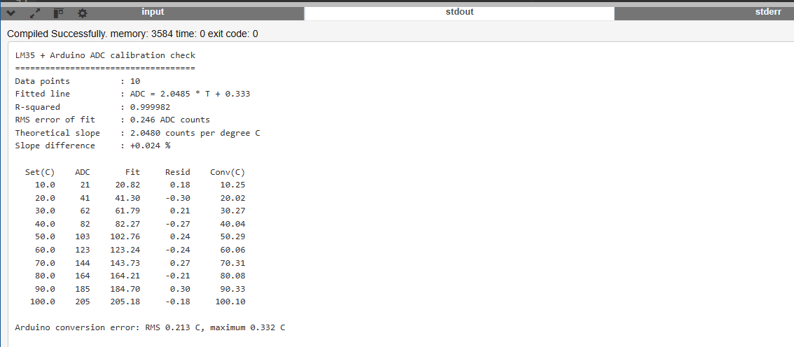

# LM35 Sensor Calibration Check in C

A small C program that checks how well an LM35 temperature sensor, read by an Arduino Uno's 10-bit ADC, follows the theoretical conversion. It fits a least-squares line to readings taken at known temperatures in a Proteus simulation and compares the result with theory.

This follows on from my [Arduino smart home automation project](https://github.com/philip-derrick/arduino-smart-home-automation), which converts LM35 readings to degrees Celsius.

## Result

| Quantity | Measured (this data) | Theory |
|----------|----------------------|--------|
| Slope (ADC counts per °C) | 2.0485 | 2.048 |
| Intercept (counts) | 0.333 | 0 |
| R² | 0.999982 | 1 |
| Largest fit residual | 0.30 counts | |
| Arduino conversion error | RMS 0.213 °C, maximum 0.332 °C | |

The slope differs from the theoretical value by +0.024 %, so the `temperature = reading × 5 × 100 / 1024` conversion used in the Arduino code is correct for this sensor model.



## Method

1. **Data collection.** In Proteus, I set the LM35 to ten known temperatures (10 °C to 100 °C in steps of 10) and read the ADC value at each one from the Arduino's serial output through a Virtual Terminal (`sketch/adc_logger`).
2. **Theory.** The LM35 outputs 10 mV per °C and the ADC has 5 V / 1024 per count, so the expected slope is 0.010 / (5 / 1024) = 2.048 counts per °C.
3. **Analysis.** `src/lm35_regression.c` fits `ADC = m × T + c` by least squares and reports R², the RMS error of the fit, the difference from the theoretical slope, and the error when each reading is converted back to °C with the Arduino formula.

## Files

```
src/lm35_regression.c      Least-squares fit and error analysis
data/lm35_calibration.csv  Set temperature and ADC reading, 10 points
sketch/adc_logger/         Arduino sketch that prints ADC readings over serial
results/output.png         Program output
```

## How to run

With GCC:

```
gcc src/lm35_regression.c -o lm35_regression -lm
./lm35_regression < data/lm35_calibration.csv
```

Or in an online C compiler such as OnlineGDB: paste the program, choose **Text** as standard input, paste the contents of the CSV file, and run.

## Notes and limitations

- **The data comes from a simulation**, not from a physical sensor. The temperatures were set by hand in the Proteus LM35 model, so this checks the conversion and the ADC model, not real-world sensor accuracy.
- Only ten points were used. The readings are whole ADC counts, so small residuals (up to about 0.3 counts) are expected from rounding.
- The C program and the Arduino logging sketch were drafted with AI assistance (Claude). I ran the simulation, collected and entered the data, ran the program, and checked its results against the theory.

## What I learned

- Fitting a straight line by least squares and judging it with R² and residuals
- Checking a sensor conversion formula against its datasheet figures
- Reading serial data from an Arduino in Proteus using a Virtual Terminal
- Reading input in C from standard input and formatting output with `printf`
